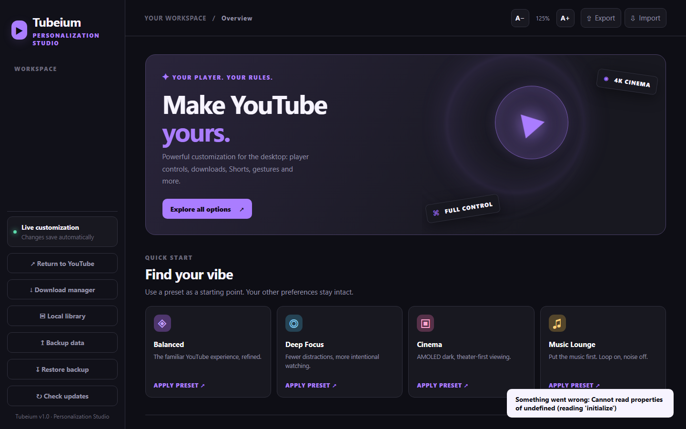
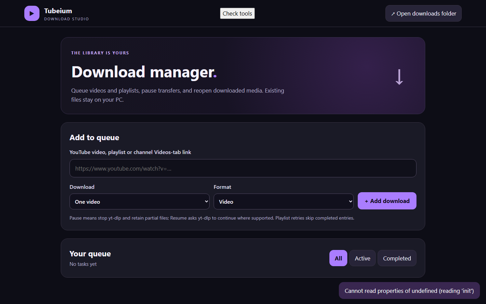
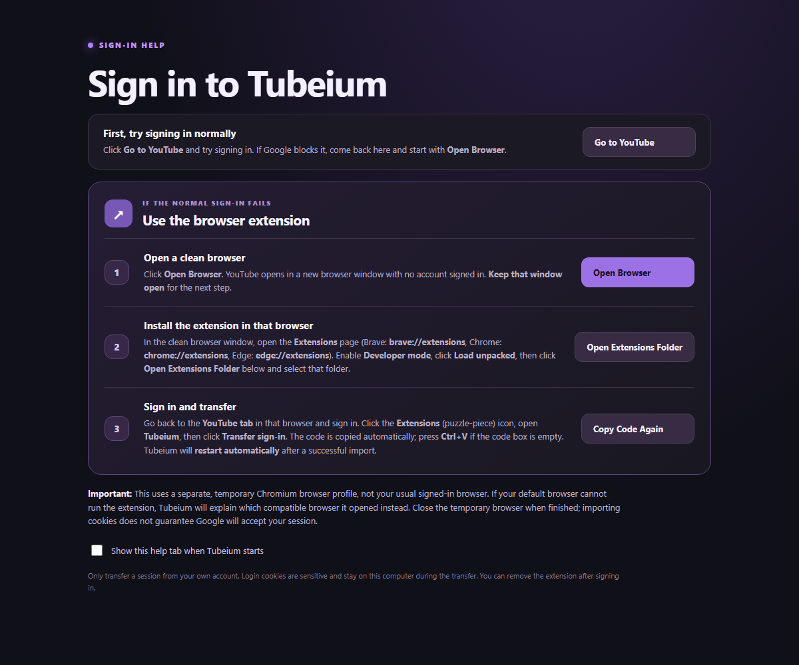

<div align="center">

# Tubeium

**YouTube, reimagined for your Windows desktop.**

A free, customizable, open-source desktop client with powerful playback controls, a distraction-free interface, local media tools, and deep personalization.

[](https://github.com/Subaru771/Tubeium/releases/latest)
[](https://github.com/Subaru771/Tubeium/actions/workflows/build-windows.yml)
[](LICENSE)
[](https://github.com/Subaru771/Tubeium/releases/latest)

### [⬇ Download for Windows](https://github.com/Subaru771/Tubeium/releases/latest) · [Explore features](#features) · [Get started](#getting-started) · [Source code](https://github.com/Subaru771/Tubeium)

</div>

---

## Why Tubeium?

Your video experience should fit **you**, not the other way around. Tubeium combines a dedicated Windows YouTube window with controls for how videos play, what appears on screen, how media is saved, and how your local library is organized.

- **Make YouTube yours:** themes, colors, layout tweaks, custom CSS, and extensive settings.
- **Watch your way:** playback speed, volume memory, quality preferences, mini player, and audio presets.
- **Cut distractions:** selectively hide Shorts, recommendations, comments, feeds, and other interface elements.
- **Keep media organized:** local playlists, bookmarks, viewing progress, downloads, and offline playback.
- **Stay in control:** privacy-oriented local tools, configurable shortcuts, and optional sign-in assistance.

> [!NOTE]
> Tubeium is an independent, **unofficial** YouTube client. It is not affiliated with, endorsed by, or sponsored by YouTube or Google. Features that rely on third-party services or YouTube's website may stop working when those services change.

**Development:** Tubeium 1.09 source includes the independent bottom-right Download/Sign-in Help controls and a rebuilt, compact two-column Settings workspace with task-first navigation and independent resize handles. These changes are not yet available as a verified Windows release. [See the planned 1.09 changes](docs/releases/v1.0.9.md).

## Screenshots

The screenshots below show **Tubeium's actual bundled interface pages**, captured directly from the project HTML and CSS on a clean Windows browser with no personal account data. They are UI captures, **not** proof of live YouTube playback, successful Google sign-in, or Windows desktop acceptance testing.

**Settings (screenshot from the earlier 1.08 release)**



**Download manager**



**Sign-in Help**



## Download Tubeium

**Tubeium 1.08 · v1.0.8 · Windows x64 · Free**

| Edition | Download | Recommended for |
| :-- | :-- | :-- |
| **Windows installer** | **[Download Setup EXE](https://github.com/Subaru771/Tubeium/releases/download/v1.0.8/Tubeium-1.0.8-Setup-x64.exe)** | Most users; standard installation and shortcuts |
| **Portable edition** | **[Download Portable EXE](https://github.com/Subaru771/Tubeium/releases/download/v1.0.8/Tubeium-1.0.8-Portable-x64.exe)** | Running without an installer |
| **SHA-256 checksums** | [Verify downloads](https://github.com/Subaru771/Tubeium/releases/download/v1.0.8/SHA256SUMS.txt) | Checking file integrity |

[What's new in 1.08](docs/releases/v1.0.8.md) · [View the official release](https://github.com/Subaru771/Tubeium/releases/tag/v1.0.8) · [All releases](https://github.com/Subaru771/Tubeium/releases)

> [!WARNING]
> **Unsigned Windows executables:** Tubeium v1.0.8 is not code-signed, so SmartScreen may display an unfamiliar-publisher warning. Only download from this repository's official Releases page. You can verify the SHA-256 checksum; do **not** turn off your security software globally.

## Features

### 🎨 Personalization & appearance

- Light, dark, system-matched, and AMOLED-style page appearance options.
- Custom accent colors, interface scaling, and separate YouTube text-size adjustments.
- Adjustable feed density, grid columns, thumbnail corners, and sidebar behavior.
- **Favorite Settings:** pin frequently used options, access them from the Favorites category, and keep their values synchronized with the original settings. Left navigation width and the lower actions section height resize independently.
- **Completely redesigned Settings:** a modern Control Room with responsive dark/light design, rich preset cards, global search, clear option rows, and faster navigation.
- Hide visual clutter such as badges, channel avatars, and hover previews.
- Optional custom CSS for advanced page styling.

### 🎬 Playback & player controls

- Preferred playback quality, default speed, speed memory, and configurable speed increments.
- **Playback Diagnostics:** open **Stats** from the floating toolbar or Player menu to see decoded resolution, estimated frames per second, dropped frames, buffering, and a local copyable report.
- **Quick Download:** one prominent video button queues the current video in a single click; use the adjacent options button for audio, thumbnails and playlists.
- **Right-side shortcuts:** the Download and Have a problem signing in? controls live together at the bottom-right. Hide either independently in Settings → Downloads; the manager opens only when explicitly requested. The default save directory is **Downloads/Tubeium**, with safe migration from legacy uYouPlus names when no conflicting destination exists.
- **Up to 4K (2160p) when supported:** the floating quality control displays the decoded video resolution (such as 1080p, 1440p or 4K) and opens YouTube’s real Quality menu. A preference for 4K is not a guarantee; the video, browser codec support and bandwidth determine available resolutions.
- Remember volume and mute state; set default volume and caption preferences.
- Theater mode, fullscreen preferences, video looping, and autoplay controls.
- Floating mini-player settings, including size, position, and Windows opacity.
- Optional audio presets such as **Bass boost**, **Voice clarity**, **Cinema**, and **Music** (availability depends on the stream).
- Configurable keyboard shortcuts and gamepad playback/seek controls.

### 🧘 Focus & cleaner browsing

Choose exactly what you want to see. Tubeium includes settings to hide or reduce:

- Shorts, homepage recommendations, related videos, and mixes.
- Comments, live chat, end screens, and in-video cards.
- Community posts, merchandise, promotional panels, and selected action buttons.
- Navigation elements, topic chips, and other feed distractions.

Changes to YouTube's interface can affect individual filters.

### ⏭ Ads & SponsorBlock

- **Best-effort ad skipping enabled by default**, with an immediate on/off toggle under **Settings → Ads & SponsorBlock**. YouTube changes can still cause ads or playback problems.
- **SponsorBlock** integration with configurable segment categories, including sponsors, self-promotion, reminders, intros, and outros.
- Optional notifications when segments are skipped.

Ad skipping is enabled by default for new installs, but it is best-effort and **does not guarantee an ad-free experience**. Turn it off under **Settings → Ads & SponsorBlock** if playback fails. Existing saved OFF preferences remain OFF. SponsorBlock separately uses community-submitted segment data.

### 📥 Downloads & offline playback

- Video and audio download options with a configurable download queue.
- Select a maximum video resolution, file naming format, and destination folder.
- Supported container preferences include **MP4** and **MKV**; audio choices include **MP3**, **M4A**, and **Opus**.
- Optional thumbnail, subtitle, and metadata handling.
- Open supported downloaded media using Tubeium's offline player.

Tubeium's first yt-dlp download is pinned to a version with a committed SHA-256. **Update Downloader** asks before selecting the latest release. Some formats and conversions require FFmpeg; availability depends on the source. Download only content you have permission to save.

### 📚 Local library & playlists

- Organize saved videos and local playlists.
- Bookmarks and playback-progress tracking.
- Local library browsing and sorting options.
- Backup and migration tools for supported local app data.

### 🔐 Privacy, sign-in & app behavior

- Local viewing profiles and privacy-oriented backup controls.
- Sign-in guidance using a browser and optional session-import workflows. Importing a personal `cookies.txt` file offers deletion only if the user explicitly selects it.
- Optional bottom Sign-in Help tabs: collapse them with **×**, then click the always-visible **↑ Show tabs** button to restore the full bar; the **View → Show Sign-in Help tabs** menu and Ctrl+Shift+G also work, and choose whether the help opens at startup.
- Startup preferences, tray behavior, window restoration, and launch-at-login options.
- External-link handling and configurable cache behavior.

**Important:** Google may block third-party or embedded sign-in. No sign-in method is guaranteed. Never share session cookies, exported sessions, or account tokens publicly.

## Feature overview

| Category | Highlights |
| :-- | :-- |
| Appearance | Themes, AMOLED option, accent colors, text scaling, custom CSS |
| Playback | Quality preferences, speed and volume memory, captions, looping |
| Player | Theater mode, fullscreen, mini player, audio presets |
| Focus | Hide Shorts, comments, recommendations, and distracting sections |
| Skipping | Best-effort ad handling, SponsorBlock categories |
| Downloads | Queue, video/audio formats, file naming, offline playback |
| Library | Local playlists, bookmarks, watch progress, backups |
| Controls | Custom hotkeys, gamepad support, Windows tray behavior |
| Account | Browser-based sign-in help and session-import options |

## Getting started

1. Download the **installer** or **portable EXE** from the links above.
2. Launch Tubeium. The installer can create shortcuts; the portable edition runs directly.
3. Open **⚙ Settings** with the floating shortcut just above the bottom bar, the bottom navigation button, or **Ctrl+,** to adjust your theme, layout, playback preferences, and downloads.
4. Explore the local library, download manager, and optional sign-in guidance.

> **Tip:** Start with the Appearance, Layout & Focus, and Playback sections to make the biggest difference immediately.

## Build from source

**Requirements:** Windows, Git, Node.js 24, and npm.

```powershell
git clone https://github.com/Subaru771/Tubeium.git
cd Tubeium
npm ci
npm start
```

To run the automated release checks and package both Windows editions:

```powershell
npm run verify:release
npm run build:windows
```

Build outputs are generated in `dist/`. Windows helper scripts are in [`scripts/`](scripts/). On Windows, run `scripts\BUILD_WINDOWS_EXE.cmd` for the installer and portable EXE, `scripts\FAST_BUILD_WINDOWS_EXE.cmd` for an installer-only build, or `scripts\RUN_WITHOUT_BUILDING.cmd` to launch from source.

**Building unreleased 1.09:** Clone the repository with your GitHub account, then check out the `fix/109-settings-workspace-and-download-flow` branch before running `scripts\\BUILD_WINDOWS_EXE.cmd`. The generated executable files remain local in `dist/` and are **not** official 1.09 release binaries.

**Actions usage:** The Windows packaging workflow is **manual-only** (Actions → Tubeium Windows build → Run workflow) so private-repository Windows runner minutes and large temporary artifacts are not consumed on every commit. Automatic source tests remain enabled. If GitHub rejects every job in seconds without starting steps, check the repository owner's **Settings → Billing and licensing** for Actions included usage, spending limits/budgets, payment warnings, and artifact storage. This is not fixed by changing the build commands. Local Windows builds via the scripts above do not require GitHub Actions.

## FAQ

<details>
<summary><b>Is Tubeium free?</b></summary>

Yes. Tubeium is distributed through GitHub, and its source code is available under the repository's [license](LICENSE).

</details>

<details>
<summary><b>Do I need a YouTube or Google account?</b></summary>

You can use supported signed-out browsing features without an account. Account-dependent functionality may require sign-in, which Google can restrict in third-party applications.

</details>

<details>
<summary><b>Does Tubeium block every ad?</b></summary>

No. Its ad filtering and skipping tools are best-effort. YouTube can change delivery methods at any time.

</details>

<details>
<summary><b>Can Tubeium download every video?</b></summary>

No. Download support varies with the video, format, availability, and upstream service behavior.

</details>

<details>
<summary><b>Why does Windows warn about the download?</b></summary>

The current EXEs are unsigned. Download only from the official release, verify checksums when appropriate, and keep your security protections enabled.

</details>

<details>
<summary><b>Is Tubeium available on macOS or Linux?</b></summary>

The currently published and tested release targets **Windows x64**. Other operating systems are not advertised as supported releases.

</details>

## Publishing a new Windows release (maintainers)

New **unsigned** releases are published manually, never automatically on every merge. Update `package.json` and the lockfile to a new version, verify CI on `main`, then run [Publish unsigned Windows release](https://github.com/Subaru771/Tubeium/actions/workflows/publish-unsigned-beta.yml) from `main` with a matching `vX.Y.Z` tag. The workflow rejects existing tags, including the published v1.0.0—and publishes only after tests, dependency audit, both Windows builds, and checksums pass.

The [signed release workflow](.github/workflows/release-windows.yml) is separate and requires explicit production approval and valid code-signing credentials. See the [release checklist](docs/RELEASE_CHECKLIST.md) and [code-signing options](docs/CODE-SIGNING.md).

## Feedback & development

Found a problem or have an idea? [**Open a GitHub issue**](https://github.com/Subaru771/Tubeium/issues). Include your Windows version, steps to reproduce, and non-sensitive logs. **Never attach cookies or account tokens.**

- [Automated builds and tests](https://github.com/Subaru771/Tubeium/actions)
- [Windows acceptance tests](docs/WINDOWS_ACCEPTANCE_TESTS.md)
- [Reproducible build notes](docs/REPRODUCIBLE_BUILDS.md)
- [Release checklist](docs/RELEASE_CHECKLIST.md)

## Privacy, security & legal

[Privacy policy](PRIVACY.md) · [Security policy](SECURITY.md) · [License](LICENSE) · [Third-party notices](THIRD_PARTY_NOTICES.md)

Tubeium is an independent community project. **YouTube** and **Google** are trademarks of their respective owners.

---

<div align="center">

### Make YouTube feel like your desktop.

**[Download Tubeium](https://github.com/Subaru771/Tubeium/releases/latest)** · [Report a bug](https://github.com/Subaru771/Tubeium/issues) · [View source](https://github.com/Subaru771/Tubeium)

</div>
